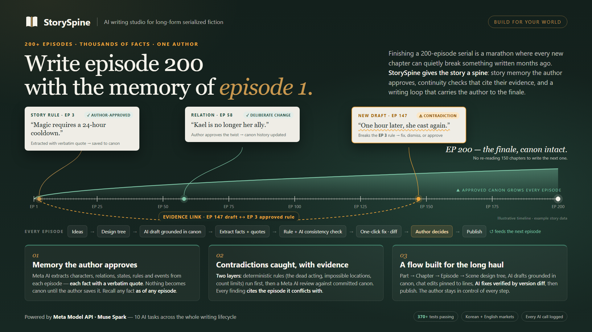

# StorySpine

**Give your story a spine.** An AI-assisted writing studio where serialized fiction authors design a novel, write it episode by episode, and keep every chapter consistent with story memory the author approved.

Brand direction: **Story Architecture** (`StorySpine` + `Give your story a spine.`). See [brand plan](docs/StorySpine_브랜드_기획안.md) and [brand images & usage guide](docs/branding/README.md).



## 2. Demo video / live demo

- Demo video: [`demo-video-3min.mp4`](demo-video-3min.mp4) (3 minutes, 1080p). English UI, demo novel *The Hidden Legacy of the Ancient Mage*: write → extract → consistency-check → fix → publish per episode. AI waiting sections are time-lapsed and labeled `edited / time-lapse`.
- Live demo: none. Judges can reproduce everything locally by following §7–§8 (requires a Meta Model API key for AI steps; checks and tests run without one).

## 3. Problem and target users

Target users: authors writing serialized web novels, where one story grows across tens or hundreds of episodes.

The problem: as a story grows, authors must track character traits, relationships, timelines, and world rules across everything written so far. Re-reading earlier chapters interrupts writing, and missed details become continuity errors that readers notice. Keyword search cannot tell a real contradiction from a deliberate change, a dream, or a retelling — that takes interpretation plus evidence.

StorySpine turns published chapters into structured, source-linked story memory. When a new chapter is reviewed, the app flags potential contradictions with the earlier evidence attached, and the author decides: fix the draft, dismiss the finding, or explicitly approve a change to the canon. Approved memory then grounds the next episode's draft.

## 4. What works in this submission

- **Ideas → Story Design.** Discuss material with AI, apply structured suggestions (synopsis changes, setting candidates), confirm the novel structure, then hand off to a Part → Chapter → Episode → Scene design tree. A design-partner chat and bulk scene expansion (`Expand`) flesh out episodes.
- **Episode writing (WRITING → IN_REVIEW → PUBLISHING).** AI draft generation per episode, direct editing with version snapshots, AI chat edits (`@L12` line pins), sequential start gate (EP N starts once EP N−1 is in review), and review requests.
- **Entity extraction with evidence.** Each reviewed episode yields change proposals — attributes, relations, states, rules, events — each carrying a verbatim quote from the manuscript. Relative expressions ("today", "here") are resolved to concrete story facts.
- **Author-approved memory.** Nothing becomes canon automatically: proposals stay pending until the author saves them. Saved facts are immediately searchable (as-of-episode cutoff, attribute history timeline) and feed later episodes.
- **Consistency analysis, two layers.** Deterministic rule checks (count limits, post-death actions, exclusive location, state clashes) always run first; then an AI review compares the draft against committed memory and the previous episode's manuscript. Findings list severity, manuscript quotes, and evidence episodes.
- **Fix loop.** Select contradictions → AI writes a fixed revision → verify with version diff → re-extract and re-analyze → publish when clean (0 open issues).
- **Publishing.** AI blurb generation, cover upload, per-episode approved-text editions, and platform registration records.
- **Bilingual + market-aware.** UI in 한국어/English; novels carry a market + writing locale (KR/ko-KR, US/en-US) driving prompts, length units, and validations.
- **Provenance.** Every AI call is logged (bundle, episode, model, preset, tokens, latency, system/user prompts) and viewable in the AI call log; a daily token budget guards spending.
- **Not in scope:** image generation, open-weight/local models, and partner inference services are not implemented or used.

## 5. How Meta products are used

Runtime AI calls go to the **Meta Model API** (`POST /v1/chat/completions` with structured JSON outputs) through a single exit point, [`server/app/meta_client.py`](server/app/meta_client.py). The model switcher offers two presets:

| Preset | Role |
|---|---|
| `muse-spark-1.3` (default) | All features below |
| `muse-wonder-1.0` | Optional flagship pick for complex work |

Implemented Meta-powered tasks: idea chat, design planning, episode drafting, entity extraction, proposal verification, consistency review, manuscript chat edits, AI contradiction fixes, quality review, and blurb generation. Locale-specific prompts live in [`server/app/prompts/`](server/app/prompts/); every call records model, preset, tokens, and prompts for the AI call log.

Development assistance is separate from runtime: this project was built with **Muse Code** (agentic coding: implementation, tests, docs). See [development log](docs/muse-code-development-log.md). No partner technologies (Fireworks/Modal/Baseten) and no image/voice models are used.

## 6. Architecture and author-approved memory flow

```text
browser ── static HTML/CSS/JS (no build step, served by FastAPI at /)
server  ── FastAPI + SQLite (data/studio.db, auto-created, git-ignored)
AI      ── Meta Model API via server/app/meta_client.py (sole AI exit)
```

Episode pipeline per chapter:

```text
Ideas ─handoff─> Design tree ─start─> WRITING ─submit──> IN_REVIEW ─publish─> PUBLISHING
                                                  │                          │
                        extract ──> pending proposals (quotes attached)       │
                        verify  ──> deterministic checks + AI review          │
                        save    ──> author-approved committed memory ─────────┘
                                                     (grounds next episode)
```

Core paths: state machine [`server/app/state_machine.py`](server/app/state_machine.py), memory store `server/app/memory.py`, consistency engine [`server/app/consistency.py`](server/app/consistency.py), drafting `server/app/drafting.py`, extraction `server/app/extraction.py`, API routes `server/app/routes/`.

## 7. Quick start and environment variables

Requirements: Python 3.11+, a Meta Model API key. Dependencies: [`server/requirements.txt`](server/requirements.txt) (FastAPI, Uvicorn, Pydantic, HTTPX, certifi, pytest).

```bash
# 1. Environment
cp .env.example .env
# put MODEL_API_KEY in .env (never commit it)

# 2. Dependencies + tests (no API key needed, ~1 min)
python -m venv .venv
.venv/bin/pip install -r server/requirements.txt
cd server && ../.venv/bin/python -m pytest -q   # 368 passed
cd ..

# 3. Start (http://127.0.0.1:8000, health: /api/v1/health)
cd server && ../.venv/bin/python -m uvicorn app.main:app --port 8000

# 4. Open http://127.0.0.1:8000 in a browser (no build step)
```

Windows PowerShell uses `.venv\Scripts\...` paths instead of `.venv/bin/...` (same commands otherwise).

Environment variables ([`.env.example`](.env.example)):

| Variable | Default | Description |
|---|---|---|
| `MODEL_API_KEY` | (required) | Meta Model API key. Server refuses to boot without it |
| `MODEL_BASE_URL` | `https://api.meta.ai/v1` | API endpoint |
| `MODEL_TEXT_ID` | `muse-spark-1.3` | Default text model |
| `MODEL_MODE` | `standard` | Data mode |
| `REQUEST_TIMEOUT_S` | `120` | Per-call timeout. Long English drafts (~9k tokens) can exceed the read gap — raise to `300` if generation stalls |
| `LLM_MAX_RETRY` | `3` | Retries on network/5xx/429 |
| `MAX_TOKENS_PER_CALL` | `8000` | Per-call cap (reasoning included) |
| `DAILY_TOKEN_BUDGET` | `1000000` | Daily token budget per user (UTC); episodes escalate to the author when exhausted |
| `EPISODE_RETRY_LIMIT` | `3` | Per-episode retry cap |

Security posture: the API key lives only in the server process; UI responses and logs never include it (covered by tests). `.env` is git-ignored and has never been committed — verified via `git log --all -- .env` plus a secret-pattern scan of tracked files.

## 8. Sample story and reproduction steps

Self-authored samples (no rights issues; written for this project):

- [`Sample_English_Story.md`](Sample_English_Story.md) — English demo story (*The Hidden Legacy of the Ancient Mage*), the demo video's input material.
- [`samples/injection_cases.json`](samples/injection_cases.json) — approved EP1 facts plus a contradiction case (`cool-01`, expect `error`), a homonym case (`homo-01`, expect split, not merge), and a normal-recall case (`recall-01`, expect no error), each with expected verdicts and rationale.
- [`evals/cases.json`](evals/cases.json) — 12 deterministic contradiction/normal pairs for the rule checks (count limits, post-death actions, exclusive location), with quote-honesty validation. See [evals/README.md](evals/README.md).

Reproduce without an API key (deterministic):

```bash
cd server
../.venv/bin/python -m pytest tests/test_eval_quality.py -q  # 12 eval cases, no LLM
../.venv/bin/python -m pytest -q                               # full suite, 368 passed
```

Reproduce the full workflow (needs `MODEL_API_KEY`):

1. Register a user, UI language English, create a novel with market **United States · en-US**, e.g. *The Hidden Legacy of the Ancient Mage*.
2. In Ideas, paste sections of `Sample_English_Story.md` into the chat, apply the setting/synopsis suggestions, set structure to no Parts/Chapters and 3 total episodes, then hand off to Story Design.
3. In Story Design, select EP1 and use Child design → Expand to create scenes; repeat for EP2/EP3.
4. In Writing, start EP1, then request review. In Review: run entity extraction, inspect the proposals (name, kind, quote, episode, memory version), save entities, run full analysis, and check the issue list (severity, evidence episode, related facts).
5. Select issues → AI-fix → verify the new revision with version diff in Writing → request review again → re-extract and re-analyze until 0 open issues → request publishing.
6. Repeat for EP2/EP3, inspect accumulated memory in Settings, and confirm per-episode editions plus the AI call log prompts in Publishing.

Expected result: each episode completes the cycle and publishes; EP2+ analyses ground themselves in EP1's committed memory and manuscript. AI outputs are non-deterministic, so exact findings vary — the deterministic checks in `evals/cases.json` are the stable assertions.

## 9. Evaluation results and limitations

Measured results (all small-sample; see [`evals/결과_20261028.md`](evals/결과_20261028.md), [`evals/실측_20261028.md`](evals/실측_20261028.md), [`evals/주입실험_20261028.md`](evals/주입실험_20261028.md)):

- Injection pairs: contradiction detected 1/1, false positives 0/2 — tuning sample (n≤3), **not** general accuracy; a held-out confirmation set is not yet written or measured.
- Quote grounding: 3/3 manual spot-checks passed (plus unit-level checks); sample too small for a rate claim.
- Pipeline completion: 3/3 sample episodes through the full cycle.
- Cost/latency (ko-KR, `muse-spark-1.3`, ~5k-char episodes): ~56k tokens and ~170 s per episode (3-episode total: 21 calls, in=49,866/out=119,041 tokens, 537 s wall clock). Cost in currency not computed (rate card pending).
- Deterministic suite: 12/12 eval cases (`test_eval_quality.py`, no LLM) and 368/368 pytest tests green.

Limitations, stated plainly:

- No evaluation with working authors yet; no held-out accuracy numbers.
- Verified at demo scale (a few episodes per novel), not hundreds of chapters.
- Long generations are slow (minutes per episode draft) and can hit read-gap timeouts — see `REQUEST_TIMEOUT_S` above.
- Image generation is not implemented; all evidence is text.

## 10. Credits, licenses, and reused components

- Runtime AI: Meta Model API (`muse-spark-1.3`, optional `muse-wonder-1.0`). No partner inference, no open-weight models, no image/voice models.
- Development: built with Muse Code ([log](docs/muse-code-development-log.md)); design decisions recorded in [`docs/구현계획.md`](docs/구현계획.md) (authoritative spec) and [`docs/muse-code-development-log.md`](docs/muse-code-development-log.md).
- Open-source runtime deps (see [`server/requirements.txt`](server/requirements.txt)): FastAPI, Uvicorn, Pydantic, HTTPX, certifi, pytest.
- Fonts are OS/browser font stacks (Pretendard/Noto fallbacks) — no vendored font files. Brand symbol, mockups, and sample stories are original to this project ([branding guide](docs/branding/README.md)); no third-party images or manuscripts are included.
- **License: [TBD — a LICENSE file must be added before the repository goes public]**.
