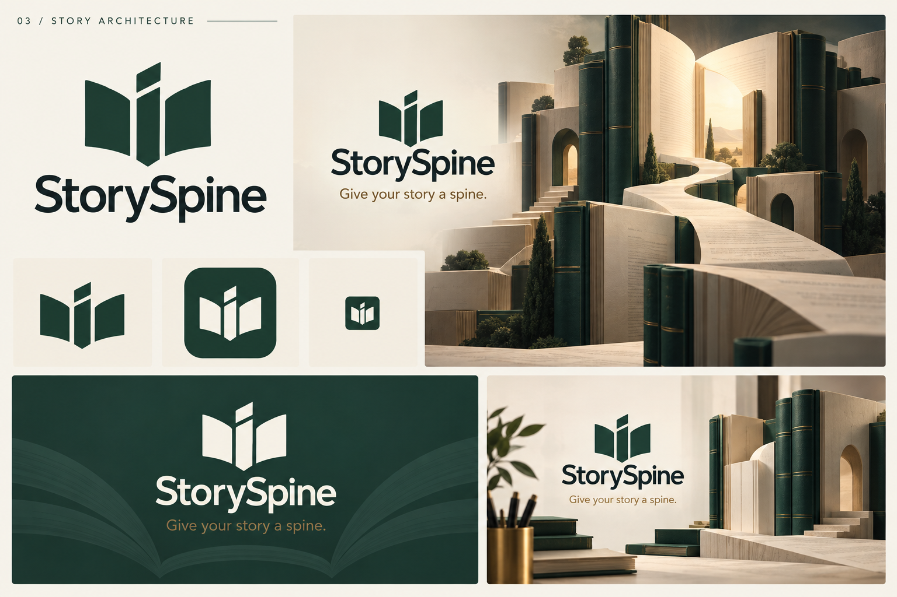

# StorySpine · Story Architecture

브랜드 방향 확정일: 2026-10-30

선택: 사용자 승인 C안 · Story Architecture

브랜드 보드 버전: v1

## 채택한 정체성

**열린 책 + 중앙의 등뼈 + 다음 장으로 이어지는 길.**

열린 책의 양쪽 페이지와 중심축을 단순한 심벌로 표현한다. 히어로에서는 책과 페이지를 건축으로 확장하고, 그 사이를 잇는 길로 장편의 구조와 창작 여정을 보여 준다.

| 요소 | 적용 기준 |
|---|---|
| 이름 | StorySpine / 스토리스파인 |
| 한국어 슬로건 | 이야기의 뼈대를 세우고, 완결까지 함께. |
| 영어 슬로건 | Give your story a spine. |
| 워드마크 | C안의 현대적인 산세리프 방향. 최종 서체는 별도 선정 |
| 심벌 | 열린 책의 페이지와 중앙 축. 최종 형태 정제 후 모든 매체에서 동일하게 사용 |
| 기본 색 | Paper `#F7F4EC`, Forest `#214E40`, Ink `#202C29` |
| 보조 색 | Brass `#A77B3E`를 제한적으로 사용 |
| 표현 원칙 | 로고는 평면 단색, 입체·질감·빛은 히어로와 캠페인 이미지에서 사용 |

## 매체별 제작 기준

| 매체 | 제작 방향 | 현재 상태 |
|---|---|---|
| favicon | 글자 없는 단순 심벌, 16·32·48px에서 중앙 간격과 형태 확인 | 보드 예시만 존재 |
| 앱 아이콘 | 녹색 바탕과 아이보리 심벌, 플랫폼 마스크를 고려한 여백 | 보드 예시만 존재 |
| 로고 | 심벌 단독, 가로 조합, 밝은·어두운 배경용, 투명 배경 | 보드 예시만 존재 |
| hero | 책과 길의 건축 이미지. 본문·버튼은 실제 웹 텍스트로 분리 | 보드 예시만 존재 |
| 발표 자료 | 녹색 표지, 아이보리 심벌과 워드마크, 짧은 슬로건 | 보드 예시만 존재 |
| 마케팅 자료 | 동일 심벌과 책의 건축 이미지를 사용하고 용도별 여백 확보 | 보드 예시만 존재 |

위 표는 제작 기준이며 완성 파일 목록이 아니다. favicon의 작은 예시는 실제 픽셀 크기 테스트를 통과한 결과가 아니다. 생성 보드에 포함된 글꼴·색·미세한 형태는 제작 시 정규화한다.

## 보관 파일과 출처

- 채택 보드: `storyspine-brand-board-v1.png`.
- 생성 원본: [C안 원본](../storyspine-concepts/03-story-architecture.png). 채택 보드는 이 파일을 변경 없이 복사했다.
- 제작 방식: 내장 `image_gen` 도구로 생성한 PNG. 1536 × 1024px.
- 원문 프롬프트: [시안 문서의 C / STORY ARCHITECTURE](../storyspine-concepts/README.md#c--story-architecture). 공통 요구사항을 포함한 전체 프롬프트를 보관한다.
- A·B안: [시안 폴더](../storyspine-concepts/README.md)에 비교 이력으로 보관.

브랜드 방향 채택과 이미지 파일 보관을 완료했다. 앱 화면 적용, 개별 에셋 제작, 상표·도메인 확인은 별도 작업이다. 이번 이미지 생성은 브랜드 디자인 자료 제작이며 제품 런타임의 Meta 모델 사용 구성과 구분한다.
